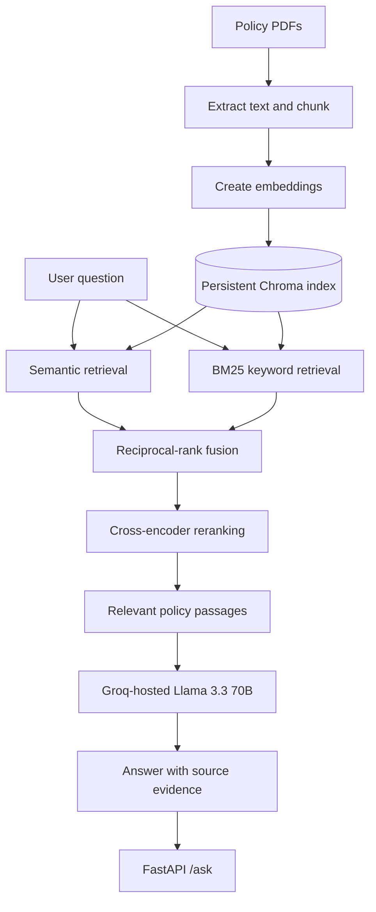

# 🛡️ Insurance Policy RAG Assistant

<div align="center">

### Understand policy wording. Find evidence. Follow the source.

**An evidence-grounded insurance policy assistant that retrieves relevant policy passages, reranks evidence, and generates answers with document and page citations.**

[📂 Source Code](https://github.com/EjazBhai/Insurance-Policy-RAG-Assistant) · [🐛 Report an Issue](https://github.com/EjazBhai/Insurance-Policy-RAG-Assistant/issues)


</div>

---

## 💡 The idea

Insurance policy documents can be long, detailed, and difficult to navigate. Customers and developers often need to locate a precise clause, understand its wording, and verify where an answer came from.

**Insurance Policy RAG Assistant** uses retrieval-augmented generation (RAG) to search policy documents and produce answers grounded in retrieved passages. It combines semantic search, BM25 keyword retrieval, reciprocal-rank fusion, and cross-encoder reranking before sending relevant evidence to an LLM.

The objective is not to replace the policy wording. It is to make relevant evidence easier to find and inspect.

## ⚡ What it does

| Capability | Description |
|---|---|
| 📄 Policy document ingestion | Extracts text from policy PDFs, chunks the text, and prepares it for retrieval |
| 🔎 Semantic retrieval | Finds passages by embedding similarity |
| 🔤 Keyword retrieval | Uses BM25 to capture important exact terms and phrases |
| 🔀 Hybrid ranking | Combines retrieval rankings using reciprocal-rank fusion |
| 🎯 Cross-encoder reranking | Reorders candidate passages by relevance |
| 🤖 Evidence-grounded answers | Uses retrieved passages as context for generation |
| 📌 Source citations | Returns source document, page, and supporting snippet where available |
| 🛑 Evidence-aware abstention | Instructs the model to say when indexed evidence does not support an answer |
| ⚙️ API interface | Exposes a FastAPI `/ask` endpoint and interactive API documentation |
| 🧪 Evaluation workflow | Measures retrieval hit rate, MRR, groundedness estimates, and latency |

## 🏗️ Architecture



The retrieval pipeline is designed to improve evidence relevance before generation. The answer should be checked against the cited policy wording, especially for exclusions, waiting periods, limits, conditions, and other coverage details.

## 📊 Evaluation results

### Retrieval benchmark

The recorded benchmark used **40 labelled questions**. A retrieval hit means the expected source file and page appeared among the top five results.

| Retrieval strategy | Hit Rate@5 | MRR |
|---|---:|---:|
| Semantic search | 78% | 0.630 |
| Hybrid search (semantic + BM25) | 82% | 0.670 |
| **Hybrid search + cross-encoder reranking** | **93%** | **0.790** |

### Generation evaluation

| Metric | Recorded result |
|---|---:|
| Questions evaluated | 30 |
| Answered rate | 100% |
| LLM-judged groundedness | 97% |
| Median latency | 9.05 seconds |
| P95 latency | 11.82 seconds |

**How to interpret these numbers:** These are results from the project's current evaluation set, not a guarantee of real-world accuracy. Groundedness is an LLM-judge estimate rather than independent human verification. Questions were derived from indexed policy chunks, which may make retrieval results optimistic. Broader evaluation on unseen policies and human-reviewed examples remains important.

## 🧰 Technology stack

| Layer | Technology |
|---|---|
| Language | Python |
| API | FastAPI, Uvicorn |
| Embeddings | `BAAI/bge-small-en-v1.5` |
| Vector database | ChromaDB (persistent) |
| Keyword search | `rank-bm25` |
| Ranking fusion | Reciprocal-rank fusion |
| Reranker | `cross-encoder/ms-marco-MiniLM-L-6-v2` |
| Answer generation | Llama 3.3 70B via Groq API |
| Evaluation dashboard | Streamlit |
| Tests | Pytest |
| Packaging | Docker / Compose configuration |

## 🚀 Run locally

### 1. Clone the repository

```powershell
git clone https://github.com/EjazBhai/Insurance-Policy-RAG-Assistant.git
cd Insurance-Policy-RAG-Assistant
```

### 2. Create a virtual environment and install dependencies

```powershell
python -m venv .venv
.\.venv\Scripts\Activate.ps1
python -m pip install --upgrade pip
python -m pip install -r requirements.txt
```

### 3. Configure the Groq API key

Create a local `.env` file in the project root:

```env
GROQ_API_KEY=your_groq_api_key
```

Get a key from [Groq Console](https://console.groq.com/). **Never commit your actual `.env` file, expose API keys in screenshots, or print secrets into logs.**

### 4. Add policy documents and build the index

Place supported policy PDF files under `data/raw/`, then run:

```powershell
python -m src.ingest
```

Use documents you are authorised to access. Sample policy sources used for evaluation are listed below; they are not redistributed in this repository.

### 5. Start the API

```powershell
uvicorn src.api:app --reload
```

Open [http://127.0.0.1:8000/docs](http://127.0.0.1:8000/docs) to explore the interactive API documentation and try the `POST /ask` endpoint.

> Check the repository's current configuration and deployment notes if your environment uses different entry points or environment variables.

## 💬 Example request

```json
{
  "question": "Is dental treatment covered?"
}
```

The response includes an answer, source evidence such as document/page/snippet, and latency. Actual coverage depends on the policy documents that have been indexed. When the retrieved evidence does not support an answer, the system is instructed to abstain rather than invent a coverage decision.

## 🧪 Run evaluation and tests

Run the retrieval benchmark:

```powershell
python -m eval.hit_rate
```

Run the generation evaluation (requires configured LLM credentials):

```powershell
python -m eval.judge
```

Run automated tests:

```powershell
python -m pytest -q
```

Evaluation reports are written to:

- `eval/results_retrieval.md`
- `eval/results_generation.md`

The Streamlit dashboard code and its deployment notes are under `eval/hf_space/` and `eval/HUGGING_FACE_DEPLOYMENT.md`. That dashboard displays evaluation reports and is separate from the user-facing policy Q&A API.

## 🗂️ Project structure

```text
Insurance-Policy-RAG-Assistant/
├── src/
│   ├── api.py                  # FastAPI API
│   ├── ingest.py               # PDF ingestion and indexing
│   └── ...                     # Retrieval and application modules
├── data/
│   ├── raw/                    # Add policy PDFs locally
│   └── eval/                   # Labelled evaluation questions
├── eval/
│   ├── hit_rate.py             # Retrieval benchmark
│   ├── judge.py                # Generation evaluation
│   ├── results_retrieval.md    # Recorded retrieval results
│   ├── results_generation.md   # Recorded generation results
│   └── hf_space/               # Evaluation dashboard
├── tests/                      # Automated tests
├── requirements.txt
├── Dockerfile
├── compose.yaml
└── README.md
```

Some files and modules are omitted from this overview for readability. See the repository for the complete structure.

## 🔐 Security and responsible use

The project is designed around evidence-backed responses, but it is not a guarantee against hallucinations or retrieval mistakes.

- Treat citations as an invitation to inspect the original policy wording.
- Do not rely on an AI response alone to make a claim, purchase, or coverage decision.
- Never place API keys in source code or commit local environment files.
- Keep policy documents and any derived index in accordance with applicable permissions and data-handling requirements.
- Verify exclusions, limits, waiting periods, definitions, and exceptions against the current policy contract.

## ⚠️ Limitations

- The evaluation set is relatively small and may not represent unseen policy documents or real customer questions.
- Generation groundedness is estimated by an LLM judge; independent human review is still needed.
- Similar wording across insurers may affect retrieval and source attribution.
- Image-only scanned PDFs are not supported unless OCR is added.
- Groq rate limits, model availability, network conditions, and hosting resources can affect latency and availability.
- The project helps locate and explain policy wording; it does not replace the full policy contract, insurer confirmation, or professional advice.
- The current evaluation does not establish broad, independently verified answer accuracy.

## 📚 Sample policy sources

The evaluation used publicly available policy documents. These PDFs are **not redistributed in this repository**. Retrieve the current versions from the relevant publisher and review their terms before use.

- [Universal Sompo — A Plus Health policy wording](https://www.universalsompo.com/assets/file/a-plus-health-insurance/a-plus-health-insurance-policy-wording.pdf)
- [IFFCO Tokio — Health Protector policy wording](https://www.iffcotokio.co.in/content/dam/iffcotokio/iffco-pdf/sites/default/files/pdf/Health%20Protector%20Policy%20Wording.pdf)
- [United India Insurance — Individual Health Insurance prospectus](https://uiic.co.in/web/sites/default/files/Policy-Document/20240325_Prospectus_IHIP.pdf)
- [Religare — Health Care Advantage policy wording](https://www.eindiainsurance.com/brochure/religare-health-care-advantage-policy-wordings.pdf)

## 🐳 Docker

A Dockerfile and Compose configuration are included for container-based setup. Review the current Compose file and required environment variables before running:

```powershell
docker compose up --build
```

Keep credentials in an untracked local `.env` file or a secret manager. Never hard-code secrets into the image or commit them to Git.

## 🛣️ Roadmap

- [x] PDF ingestion and retrieval pipeline
- [x] Semantic and BM25 hybrid retrieval
- [x] Reciprocal-rank fusion and cross-encoder reranking
- [x] Evidence-backed answers with source information
- [x] Retrieval and generation evaluation scripts
- [x] FastAPI interface and interactive API documentation
- [ ] Expand evaluation with unseen policy documents and independently authored questions
- [ ] Add more human-reviewed answer-grounding checks
- [ ] Improve handling of scanned PDFs with OCR
- [ ] Add structured tracing and runtime monitoring
- [ ] Extend deployment hardening and load testing

## 📄 License

MIT — see [LICENSE](LICENSE).

---

<div align="center">

**Built to explore a practical question: how can AI make complex insurance wording easier to navigate while keeping answers tied to evidence?**

⭐ If you find the project useful, consider starring the repository.

</div>
